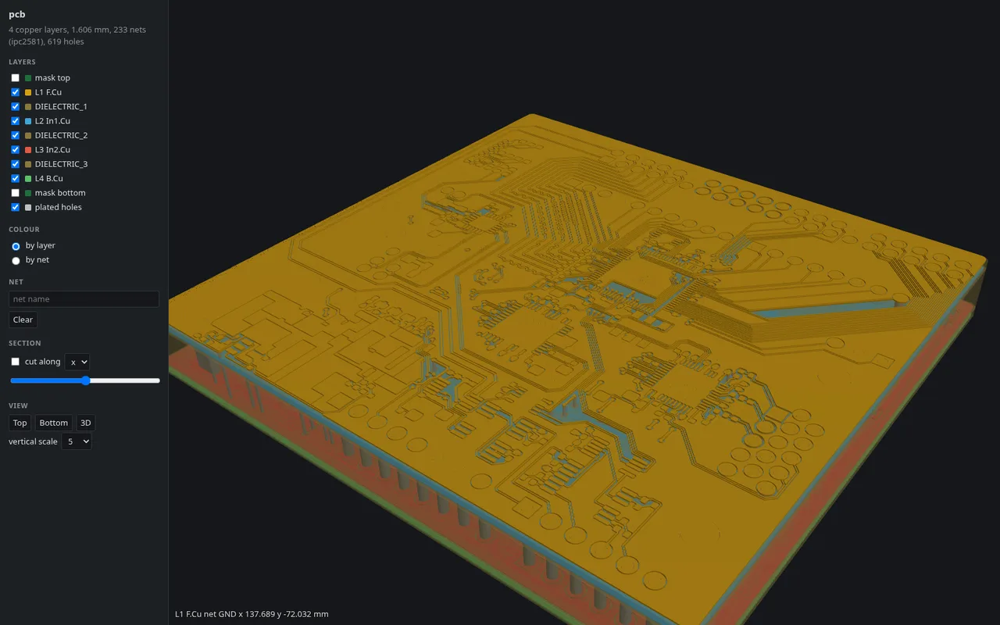
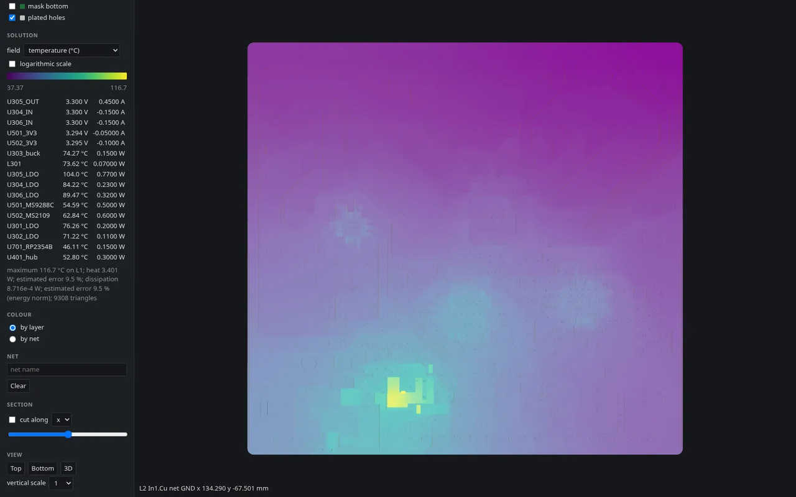
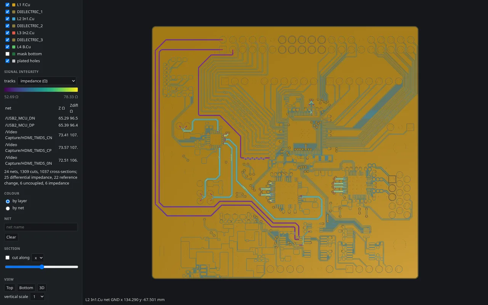

# KairoQ

Electrical, thermal, electromagnetic and signal-integrity analysis of finished printed
circuit boards, from the fabrication data every design program exports.

KairoQ (pronounced *kai-ro-ki*) reads a board from IPC-2581, ODB++ or Gerber and drill
files into one documented model, shows it in a 3D view in the browser, and analyses it.
Every result it reports is checked against an analytical solution, published data or an
independent solver; the checks are in the test suite and summarised in the validation
notes.



| temperature | impedance of the routed traces |
| --- | --- |
|  |  |

A four-layer interface board (`testdata/de10_interface`, analysed by
`examples/de10_interface.yaml`): its stack in 3D, the temperature with assumed component
powers in still air, and the impedance of its USB, HDMI and clock traces.

## What it computes

| analysis | results | validated against |
| --- | --- | --- |
| DC current | voltage drop, current density, via currents, Joule heat | closed forms; Elmer (3D FEM) on a 6-layer board |
| thermal | steady and transient temperature, electrothermal coupling, heat sinks | closed forms; a 3D reference; Elmer on a region of a real board; IPC-2152 data |
| EMI estimates | loop inductance, resistance and radiated field, return-path gaps and stitches, switch-node capacitance | closed forms; openEMS |
| transmission lines | impedance, delay and loss of nets and pairs, from FEM cross-sections | closed forms; the design's net classes |
| channels | S-parameters, mixed mode, TDR, crosstalk, vias, Touchstone | TEM coupler; openEMS; measured S-parameters of two stub lines |
| time domain and eyes | waveforms with linear or IBIS buffers; pattern and statistical eyes | an independent time-domain engine; enumeration |
| power distribution | impedance into the power planes with capacitors and their mounting | closed forms of the plane cavity and of mounting inductance |
| RF | de-embedding, patch antennas, full-wave S-parameters via openEMS | closed forms; textbook examples; openEMS |

The full-wave and 3D references are external open-source solvers (openEMS, Elmer) that
KairoQ drives: it writes their models, runs them and reads the results back.

## Inputs

| data | formats |
| --- | --- |
| copper, solder mask, board outline | IPC-2581 (revisions B, C); ODB++; Gerber X2 |
| holes | IPC-2581; ODB++; Excellon; Gerber X2 drill files |
| stackup | IPC-2581; ODB++; Gerber job file (`.gbrjob`); a short YAML file |
| nets | IPC-2581; ODB++; Gerber X2 attributes; IPC-D-356 netlist; copper connectivity |
| component positions | IPC-2581; ODB++; pick-and-place CSV |

A fabrication set can be given as files, a directory or a zip archive, an ODB++ job as a
directory, zip or tgz archive. The importers are verified on KiCad exports; exports of
other programs are untested, and reports of failures, with the files if they can be
shared, are welcome. `docs/importers.md` describes what is read and how; every importer
produces the canonical model of `docs/canonical-model.md`.

## Building

A C++20 compiler (GCC 11, Clang 14 or later), CMake 3.24 or later, and network access on
the first configuration, which downloads the pinned dependencies (`THIRD_PARTY.md`):

```
cmake -S . -B build -DCMAKE_BUILD_TYPE=Release
cmake --build build -j
ctest --test-dir build
```

Linux is supported; macOS and Windows are built and tested on a best-effort basis. This
builds the command `build/src/cli/kairoq` and the C++ tests. The Python package
(Python 3.10 or later) builds and installs with pip, together with the command:

```
pip install .
```

Development setup and conventions: `CONTRIBUTING.md`.

## Use

```
kairoq info  <input>...                   summary: stackup, layers, nets, holes, warnings
kairoq import <input>... -o board.zip      write the canonical model
kairoq view  <input>...                    3D viewer in the browser
kairoq dc    project.yaml [--view]         DC current: voltage drop, current density, hole currents
kairoq thermal project.yaml [--view]       steady or transient temperature
kairoq emi   project.yaml [--view]         loop inductance and field, return paths, switch nodes
kairoq si    project.yaml [--view]         impedance, delay and loss of nets; differential pairs
kairoq sparams project.yaml [-o dir]       S-parameters and TDR of channels; Touchstone files
kairoq waveforms project.yaml [-o dir]     time-domain response with linear or IBIS drivers
kairoq eye   project.yaml [-o dir]         eye diagrams at a bit error ratio
kairoq pdn   project.yaml [-o dir]         impedance of a power distribution network
kairoq deembed spec.yaml                   de-embedding of a Touchstone file
kairoq openems project.yaml -o dir [--loop L | --channel C]   a loop or a channel for openEMS
kairoq elmer project.yaml -o dir [--run] [--thermal]   the DC or thermal problem in 3D with Elmer
```

An input is a canonical model, an IPC-2581 file, an ODB++ job, or fabrication files. Options:
`--stackup <file.yaml>` gives the stackup when the inputs lack one or to override it;
`--arc-tolerance <µm>` sets the largest deviation of polygon chords from arcs (default
1 µm); `--crop x0,y0,x1,y1` keeps the part of the board inside a rectangle (mm), with open
edges through which no current or heat passes.

For example, on the boards in `testdata/`:

```
kairoq view    testdata/de10_interface/de10_interface.ipc2581.zip
kairoq thermal examples/de10_interface.yaml --view
kairoq si      examples/de10_interface.yaml --view
kairoq dc      examples/cm5_minima_5v.yaml --view
```

```python
import kairoq
import shapely.wkb

board = kairoq.open("fab/")            # directory, zip, IPC-2581 or model
print(board.summary())
gnd = board.nets.index("GND")
plane = shapely.wkb.loads(board.copper_wkb(2)[gnd])
kairoq.serve(board)                    # viewer
```

The 3D viewer shows the board and, with `--view`, the DC, thermal, EMI and impedance
results on it; S-parameters, waveforms, eye diagrams and PDN impedance are written as files.

Each analysis, its project-file keys and its limits are described in `docs/`: the viewer
(`docs/viewer.md`), DC (`docs/solvers/dc.md`), thermal (`docs/solvers/thermal.md`), EMI
(`docs/solvers/emi.md`), openEMS and Elmer (`docs/solvers/openems.md`,
`docs/solvers/elmer.md`), lines (`docs/solvers/si.md`), channels
(`docs/solvers/networks.md`), time domain (`docs/solvers/timedomain.md`), eyes
(`docs/solvers/eye.md`), power distribution (`docs/solvers/pdn.md`) and RF
(`docs/solvers/rf.md`).

## Validation

`docs/validation/` holds one note per analysis: what was compared, with which tolerance,
and what is not validated: [import](docs/validation/importers.md),
[DC](docs/validation/dc.md), [thermal](docs/validation/thermal.md),
[heat sinks and transients](docs/validation/thermal-transients.md),
[EMI](docs/validation/emi.md), [lines](docs/validation/si.md),
[networks](docs/validation/networks.md), [crosstalk](docs/validation/crosstalk.md),
[time domain](docs/validation/timedomain.md), [eyes](docs/validation/eye.md),
[power distribution](docs/validation/pdn.md) and [RF](docs/validation/rf.md). The Python
test run writes every compared quantity to `build/validation/report.md`.

## Limits

Each analysis lists its own in `docs/solvers/`. In general: results are as good as the
stackup and material data given; measured data enter the validation for two stub lines
only; the importers are verified on KiCad exports only. Loop inductances converge from
above and are typically 2 to 5 % high at the default triangle budget, which can be raised
(`docs/solvers/emi.md`).

## Licence

GNU General Public License, version 3 or later (`LICENSE`). Third-party components and test
data: `THIRD_PARTY.md`, `testdata/README.md`. Development practice: `DISCLOSURE.md`.
